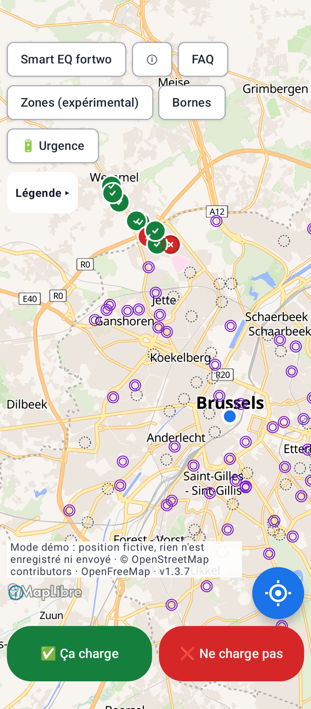
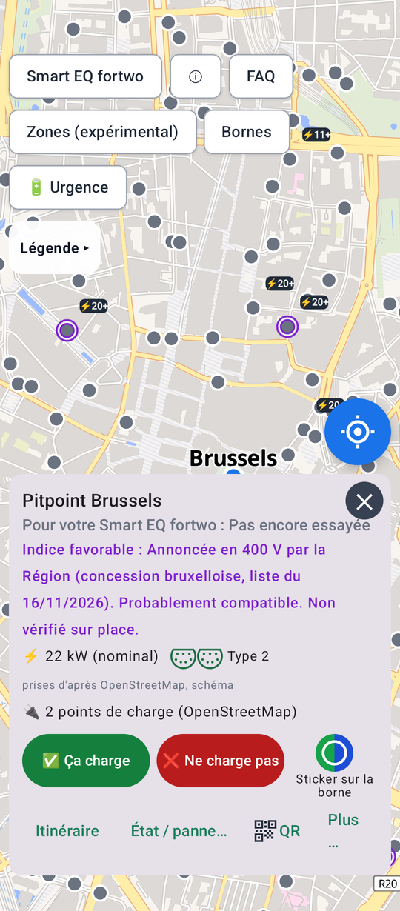
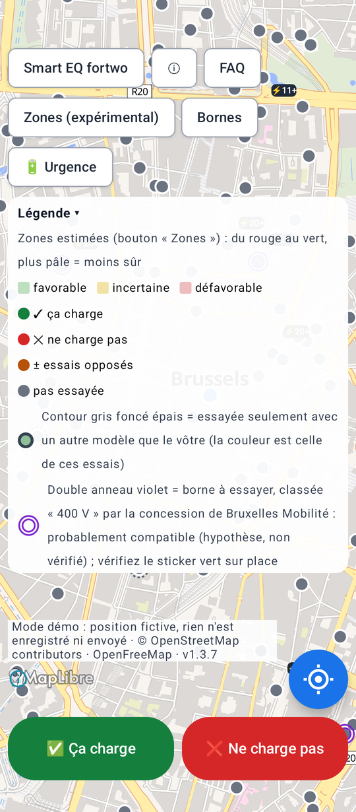
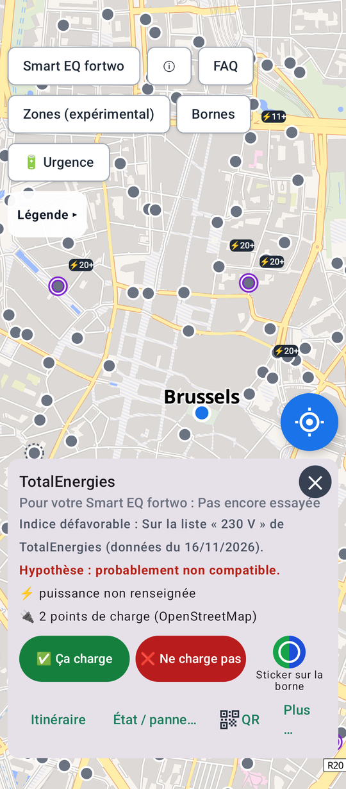
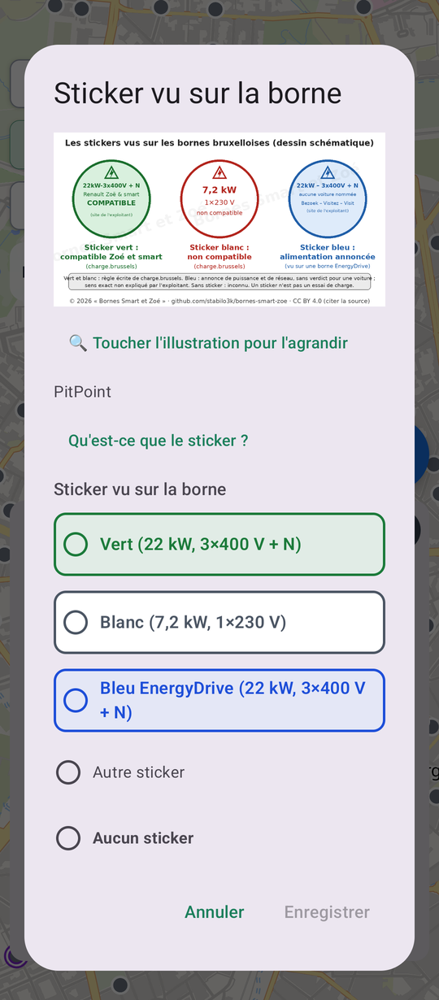
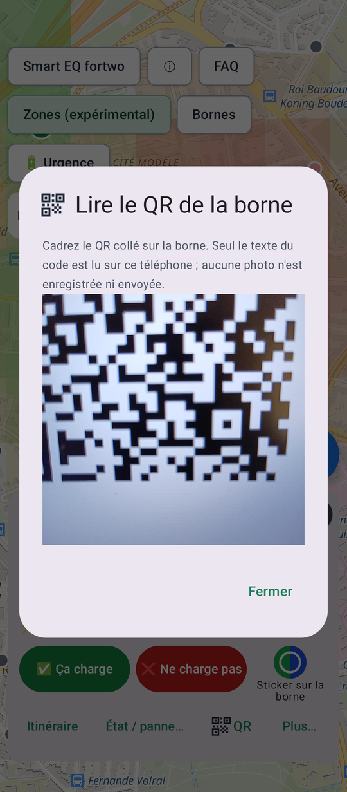
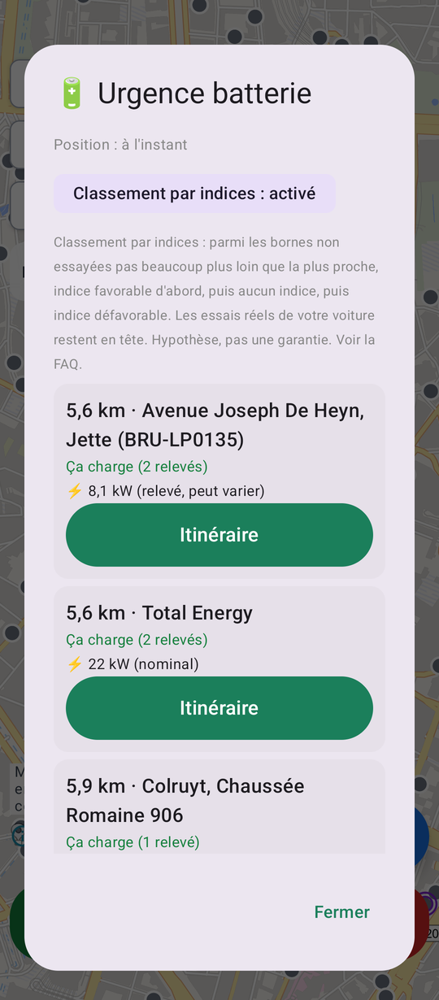
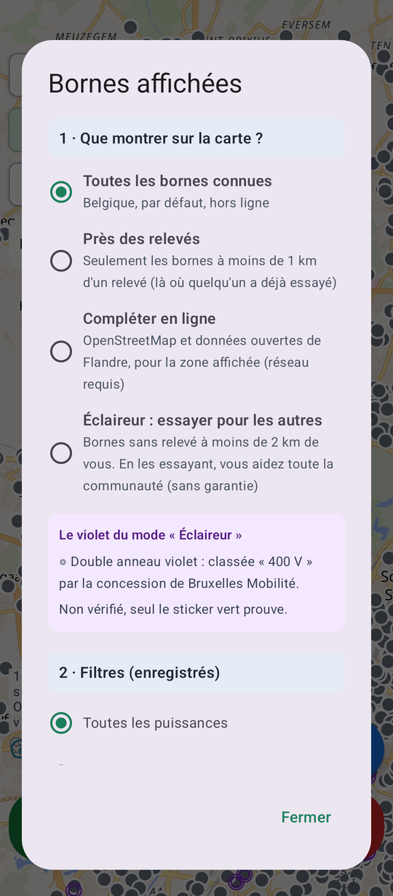
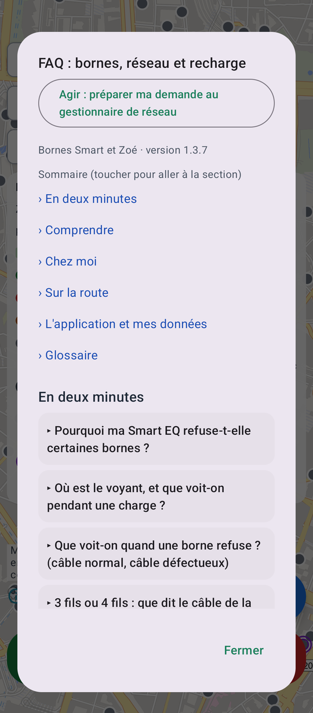
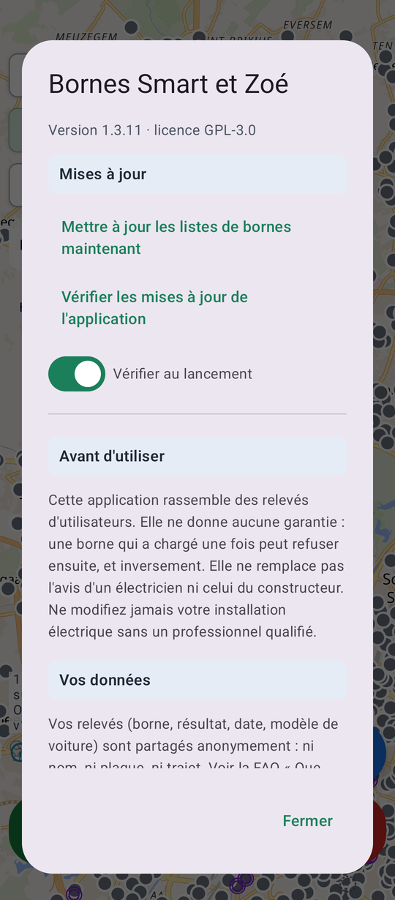

# Bornes Smart et Zoé

Application Android gratuite, libre et sans publicité : les conducteurs de **Smart EQ, Renault Zoé** et voitures voisines signalent en deux touches si une borne belge a chargé ou non leur voiture (certaines refusent les réseaux 3×230 V sans neutre).

## Installer l'application (Android)

1. Sur ton téléphone Android, ouvre la **[dernière version](https://github.com/stabilo3k/bornes-smart-zoe/releases/latest)**.
2. Descends jusqu'à « Assets » et touche le fichier **`BornesSmartZoe-….apk`** pour le télécharger.
3. Ouvre le fichier téléchargé. Android demande d'autoriser l'installation depuis ce navigateur : accepte (« Installer des applications inconnues »), puis touche « Installer ».
4. Au premier lancement, choisis ta voiture. Les relevés sont anonymes.

*English: open the [latest release](https://github.com/stabilo3k/bornes-smart-zoe/releases/latest) on your Android phone, download the `.apk` under "Assets", open it and allow installation from this browser. A listing on F-Droid has been requested.*

---

Contexte : une partie du réseau belge est en 3×230 V sans neutre. Certaines voitures refusent alors de charger. Aucune base publique n'indique le neutre ; l'information vient des essais des conducteurs.

État : version 1.3.11 (22/11/2026). Deux gros boutons « Ça charge » / « Ne charge pas » : l'app prend la position GPS, retrouve la borne (listes intégrées de Belgique et de Bruxelles, données ouvertes flamandes, OpenStreetMap), demande confirmation et enregistre. Carte colorée par voiture, fiches de borne (adresse, source, points, prises, téléphone d'assistance, boutons Appeler et Formulaire de contact pour prévenir l'exploitant), pannes et états (dont « Panne réglée »), bouton « Sticker sur la borne » (constat visuel du sticker collé sur la borne, jamais compté dans le verdict), lecture du QR de la borne (sur le téléphone, aucune image gardée), anneaux « à essayer » (violet, bornes classées 400 V par Bruxelles Mobilité) et « probablement non compatible » (gris, liste « 230 V » de TotalEnergies, données du 16/11/2026) : des hypothèses, non mesurées. Filtre « nouvelles bornes », Urgence batterie, FAQ sourcée avec sommaire, écran « À propos », mode démo (position fictive, rien n'est enregistré) et mode essai (rien n'est envoyé), export et import de vos relevés, mise à jour automatique des listes de bornes (dossier `data/`). Relevés partagés anonymes sur un serveur Supabase : installation décrite dans `docs/LISEZ-MOI-SQL.md`. Si le serveur s'arrête, l'application continue de fonctionner hors ligne.

## Captures d’écran

Mode démo (position fictive sur la Grand-Place ; aucun relevé personnel). Fonds de carte © contributeurs OpenStreetMap, OpenFreeMap, MapLibre. Certaines captures montrent une version de test antérieure à la 1.3.11 (numéro dans le coin) ; l’écran est identique.

         

Licence : GPL-3.0-or-later (fichier `LICENSE`). Compilation : `gradle assembleRelease` (Gradle 8+, pas de wrapper dans le dépôt) ; la signature de publication se passe par `-PBN_KEYSTORE=... -PBN_PROPS=...` (clé hors dépôt).

Sources de données : © contributeurs OpenStreetMap (ODbL), OpenFreeMap, Bruxelles Mobilité (CC BY 4.0), Service public de Wallonie (CC BY 4.0), liste « 230 V » de TotalEnergies / Charging Belgium (données du 16/11/2026, réutilisation autorisée par écrit), Departement Mobiliteit en Openbare Werken / Eco-Movement (Open Data Vlaanderen). Détails : `DATA-LICENCE.md`.

Aucune donnée personnelle dans ce dépôt : ni plaque, ni numéro de châssis, ni position de l'utilisateur. Politique de confidentialité (FR/EN/NL) : [`PRIVACY.md`](PRIVACY.md).

Source du code : le dossier `app/` de chaque release correspond au code de la **version 1.3.11** (commit b9f8730) ; les releases 1.3.2 à 1.3.6 ont été publiées avec un `app/` resté à la 1.3.1 (voir la note de chacune).

Projet indépendant, non affilié à Smart, Mercedes-Benz, Renault ni aux exploitants de bornes cités ; les noms de marques ne servent qu'à décrire les voitures concernées.
